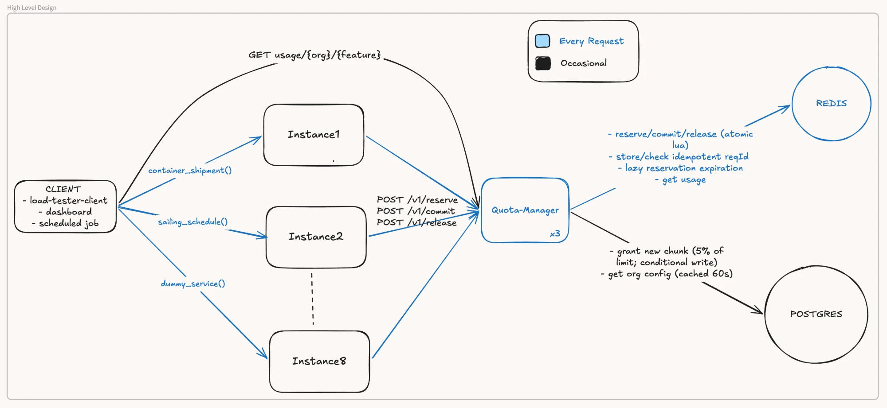
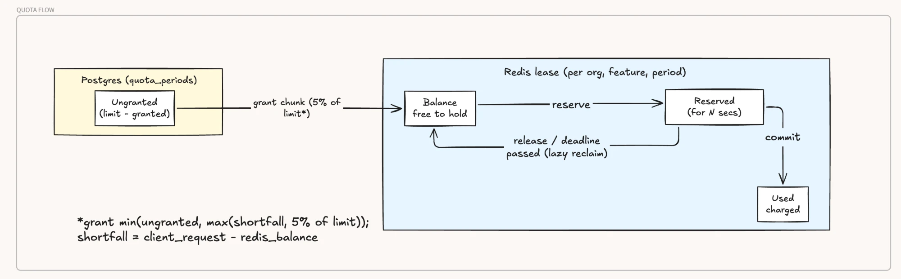
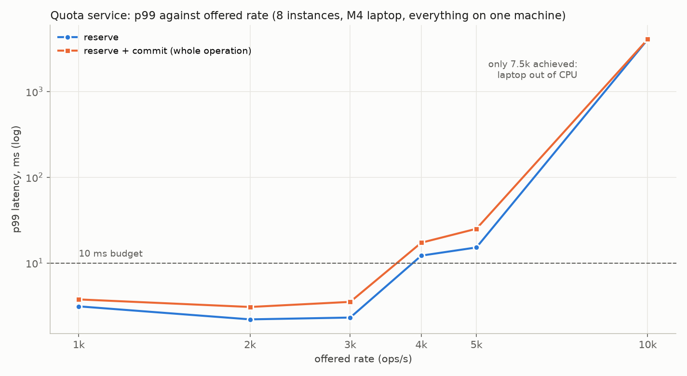
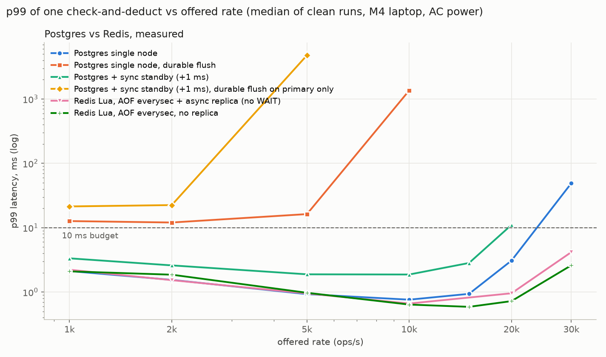

# Design

## Diagrams
Editable source: [Excalidraw](https://excalidraw.com/#json=5-Tg-QivfgdlVe37mH0nC,jMQOFOnOyPKEy11Id1DCfA)

## Assumptions
- Traffic: 2k ops/s sustained and 10k peak are today’s numbers, at about 5k orgs.
  - They grow roughly linearly, to about 20k / 100k at 50k orgs.
- Request IDs: callers send one unique request ID per logical operation and reuse it on every retry.
- Retry window: retries arrive within 1 h (IDEMPOTENCY_WINDOW_S).
- Operations finish well within the reservation timeout (RESERVE_TIMEOUT_S, 30s default; 10s in demo).
- Org plan changes are rare, so up to 60 s of staleness is acceptable.
- During an infrastructure failure, a bounded error is acceptable.
- Deployment: single region, with the service, Redis and Postgres close together.
## Integration shape
#### Chosen: Service
| | library | middleware | service |
|---|---|---|---|
| request payloads | caller decides units | must know all payloads of all features; less flexibility on how to charge | caller decides units |
| change in feature services | use the library | none | call the service (thin client) |
| deploying a change | re-deploy every feature instance | re-deploy the proxy | one service |
| connections to redis/postgres | one pool per feature instance (8 now, could be 10x by year end); pgBouncer etc needed early | proxy instances | service instances only |
| network hops | none extra | proxy hop | 1 extra per call (reserve + commit = 2 calls per operation) |
| languages | library runtime in every service, or one implementation per language | any | any (HTTP) |
| usage endpoint | needs a service anyway | needs a service anyway | built in |
| ops | - | reverse proxy management | one more service to run |

- thin client, demo version: src/demo/quota_client.py, hold() commits on success, releases on exception, retries with the same request_id
- quota service unreachable: client gets 503, the feature fails closed

## Correctness under concurrency
#### Chosen: Leases stored in Redis, granted by Postgres
- request use quota given to redis by postgres
    - redis usage is atomic via Lua scripts
    - idempotency record and deduction are in the same Lua script, so a retry can't charge again
    - request to postgres guarded by lock in redis + conditional SQL check
- invariant (normal operation, incl. concurrency and retries): ungranted (postgres) + balance + reserved + used = limit
    - crashes / redis data loss: sum <= limit (under-serve)
    - redis rollback (AOF restore, async failover) or work finishing after its reservation expired: can serve more than limit, bounded by ~1 s of traffic / the timeout
- Other options considered:
    - just postgres with conditional writes would've maintained correctness but
        - storing idempotency reqIDs would need periodic cleanup
        - would need sharding (estimated) to support 50k orgs, high operational cost
    - only redis:
        - hard to recover from redis cluster failures
- Tested by:
    - tests/concurrency/test_no_overserve.py: 2 instances x 2 workers, 200 requests in flight on one org, exact totals checked
    - 9 end-to-end checks run by `docker compose up` (see README)
      - to ensure tests actually could catch over-serving:
        - ran with disabling the balance check in redis: tests did fail

## Shared state across instances
- redis: live leases and reservations, shared by all instances
- postgres: config and the grant ledger (quota_periods.granted)
- refill lock in redis: one instance at a time takes a new grant from postgres
- stateless instances, apart from the org config cache (below)
## Quota configuration
- plans -> plan_limits (monthly limit per feature) -> orgs (plan, anchor day, status)
- changes are made in postgres; instances cache org config (plan, anchor day) for 60 s, so a change takes up to 60 s
- the period's row (quota_periods) copies the limit from the plan on first use in that period
- no admin API; seed creates 3 plans, 30 features, 5k orgs
## Batch policy
#### Chosen: all or nothing
- A request needs N units but only M < N remain: the system returns a 429, and the available units
- reserving just M units might be useful for some features but for others it might not be useful
    - users might want to specifically prioritise differently if they know fewer units in quota remain
- a diff method could be supported: reserve_at_max(N) which can reserve M units (M <= N)
    - used by features where doing partial work is actually helpful
## Failure and retries
#### Failure
- quota reservation starts with reserve() on start
    - after work completion, service is expected to call commit(), which finalizes the charge
    - on work failure, service calls release(), to return the units back to the balance redis pool
    - in case no response is received within N secs, units automatically released
        - a late commit (after N secs) is given 409 expired, and not charged
    - N = RESERVE_TIMEOUT_S (30 s default); must be longer than the downstream operation's own timeout
        - later could be configurable per feature
    - late commit behaviour could also be made configurable per feature

#### Retries
- As assumed, services provide an idempotency key that is used to identify requests
- duplicate reserve returns the original state; the client treats a duplicate on its own retry as its own hold
- duplicate commit/release are passed; conflicting commit/release get 409 (conflicting)
    - idempotency keys are maintained for a fixed window (IDEMPOTENCY_WINDOW_S, 1 h); later requests treated as new reqIDs

## Month change and Usage reporting
#### Months are per org anchors
- linked to each org's billing cycle; UTC for all
  - late arriving commits/release processed against correct key
    - lease keys in redis have 2 days ttl after period end
- end of months is clamped: 31st Jan - 28th Feb - 31st March
- each quota for an org is keyed by period as well
    - when a period switch happens, system automatically moves to using the new period keys/rows
    - no reset job: old keys expire, new ones are created on first use
- usage is served from redis
    - returns used, reserved, limit, remaining, period_start, resets_at
    - expired holds are reclaimed before reading; remaining excludes reserved units
## Load-test numbers
How to run: [bench/README.md](bench/README.md). M4 laptop, everything on one machine.

#### Service: 8 instances, reserve + commit over HTTP

- under 10 ms up to ~3k ops/s; above that the laptop runs out of CPU (redis + postgres never used more than 1.3 cores), so the 10k peak isn't shown end to end
- cold start, hot key and chunk size: [bench/service/RESULTS.md](bench/service/RESULTS.md)

#### Postgres vs Redis: p99 of one check-and-deduct against offered rate
Store-level benchmark used to choose the source of truth.

- redis with or without an async replica: no measurable difference up to 10k

## Where it falls over
- system fails closed when redis is down
    - redis is configured to save data to disk every sec
    - 1 sec worth of data can be lost in this case
        - restoring from disk backups means we can over-serve units served in last ~1s
          - using fencing tokens, we can make it err towards under-serving
        - restoring from postgres means we can under-serve since last grants are assumed to be fully depleted
        - usage endpoint under-reports used after redis data loss (used restarts from 0)
- postgres goes down
    - the system can potentially serve for a brief amount of time after postgres goes down
        - only redis is on the hot query path
    - on an error to reach postgres, the system replies with 503
- small total limit org-feature, big batches
    - potentially every call to redis can result in a new postgres grant being requested
        - same row in postgres means all SQL calls execute serially
        - measured on one key at 2k ops/s: chunk 250 fine; chunk 25 -> p99 174 ms, 4% 503s
        - fix: dynamic chunk size based on usage
- a retry after the idempotency window (1 h) is charged again
- more complex failure scenarios are also possible:
    - split brains of redis/postgres replicas
    - clock skews across servers

## Getting to 50k orgs + Production-grade
- data: 50k orgs * 30 features = 1.5M active rows * ~200 bytes = 300MB per month; small for postgres; old periods can move to object store
- cur peak = 10k; 50k orgs peak assumed = 100k
    - horizontal scaling of quota-manager service behind load balancer
    - redis sharding by org_id
        - redis keys are already hash-tagged by {org}, so redis cluster needs no key changes
### Monitoring and Alerting
- these are great candidates to set up alerting upon:
    - avg grants from postgres per sec, per feature
        - high number means default grant % for feature should be increased
    - % expired reservations
    - number of 503s returned
- async monthly comparing of actual work done (from feature service logs) to quota charged
- servers, redis, postgres cpu/io usage

## AI assistance
- my design decisions:
    - started with two options: just postgres, or redis + postgres
        - used AI to evaluate just postgres: benchmarked against redis (graph above); durable postgres setups get close to or over the 10 ms budget, and 100k ops/s at 50k orgs would need sharding, so high operational cost
    - after moving to redis, proposed the lease approach (redis leases granted from a postgres ledger)
      - AI handled the implementation edge cases
    - worked with AI on test cases that test every aspect of the design under load
- AI-assisted:
    - code written with AI (Claude Code)
    - tests and benchmarks run on my laptop by AI; graphs generated by AI
- reviewed by me:
    - some of the tests that were run
    - soem of the core service functions (reserve and refill)
