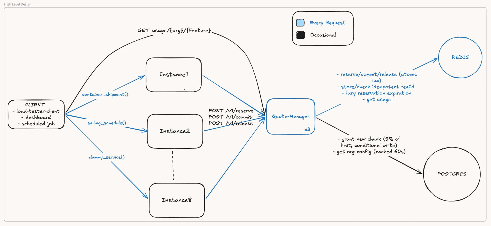
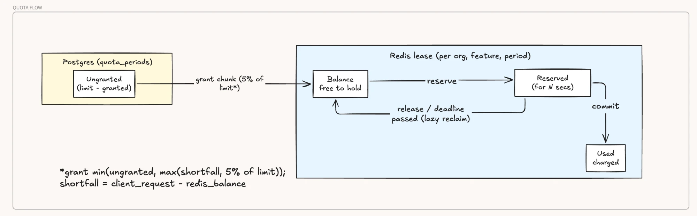

# Quota metering

Per-organization, per-feature monthly quotas, enforced across a horizontally scaled fleet.
Quota is held in Redis as leases granted from a Postgres ledger. See [DESIGN.md](DESIGN.md).





Editable diagrams: [Excalidraw](https://excalidraw.com/#json=5-Tg-QivfgdlVe37mH0nC,jMQOFOnOyPKEy11Id1DCfA)

## Run

```bash
docker compose up --build
```

One command brings up the whole system, checks it, and puts it under load:

| Service | What it is |
|---|---|
| `postgres`, `redis` | The stores: Postgres holds plans, orgs and per-period granted totals; Redis holds the live leases |
| `seed` | One-off: creates the schema, then 5,000 placeholder orgs (`org1`..`org5000`), features `feature1`..`feature30`, plans starter/pro/enterprise |
| `quota` | The quota service, **3 instances** (host ports 8000-8002; the brief's fleet is 8, change `replicas` to match). Interactive API docs: http://localhost:8000/docs |
| `dummy-tracking-feature` | A demo product service that consumes quota, **2 instances** (ports 9000-9001): `POST /v1/containers` costs 1 unit (`feature1`) per container, `GET /v1/schedules` costs 1 unit (`feature2`). It reserves, does the work, then commits, or releases if the work failed |
| `load-tester-client` | First runs the **correctness checks** (below) and prints a glossary and PASS/FAIL per test, then keeps **sustained load** of ~2,000 ops/s on dummy-tracking-feature (bursty per org, batches of 1-100, 5% downstream failures, 2% duplicate sends), printing a line every 5 s: throughput, outcomes, and the time spent waiting on the quota service (p50/p99). Every 30 s it checks a sample of orgs against their limits. Tune with `LOAD_RATE` / `LOAD_ORGS` |

Latency numbers printed by the demo are only indicative: they vary a lot with the cores given to
the Docker VM, other load on the machine, and the fact that every service shares those cores.
On an M4 laptop it holds ~2k ops/s with 0 errors and a quota overhead p50 of ~1.3 ms.
Measured numbers are in [DESIGN.md](DESIGN.md).

The reservation timeout is set to **10 s** for this demo (`RESERVE_TIMEOUT_S` in
docker-compose.yml; the service default is 30 s), so the crashed-client check does not wait long.

### Correctness checks

Run through the live stack (client -> dummy-tracking-feature -> quota service -> Redis/Postgres),
each on fresh orgs, with outcomes reconciled three ways where possible: what the client saw =
dummy-tracking-feature's ledger of completed operations = the quota usage endpoint, and
used <= Postgres granted <= limit.

| Test | What it shows |
|---|---|
| 1 | Exact fill: concurrent batches totalling exactly the limit all succeed, remaining 0 |
| 2 | Oversubscribed: 1,000 concurrent 1-unit requests against 500 -> exactly 500 succeed |
| 3 | Oversubscribed with mixed batches: never over-served, and nothing rejected that would have fitted |
| 4 | All-or-nothing: a batch that doesn't fit is rejected whole, nothing taken |
| 5 | Downstream failure: failed work releases its units |
| 6 | Retries of a successful operation (racing, same Idempotency-Key) are charged once; later resends get `200 replayed` |
| 7 | A retry of a failed operation with the same key is refused (409), not charged, not re-run |
| 8 | Crashed client: a reservation never committed or released blocks requests until its timeout, then the units return; its late commit is refused |
| 9 | Mixed load: concurrent clients, batches, failures and duplicates; every (org, feature) reconciles exactly |

From the repo folder, in another terminal or after stopping `docker compose up` with Ctrl-C. Each
command starts whatever it needs (the same list is printed after the checks):

```bash
docker compose run --rm load-tester-client check                     # all checks again
docker compose run --rm load-tester-client check 2 --requests 2000 --limit 300   # one check, own numbers
docker compose run --rm load-tester-client load --rate 1000 --orgs 500 --seconds 60   # a load run of your own
docker compose run --rm load-tester-client help                      # commands, every check's parameters, glossary
docker compose down -v                                               # stop everything and delete the data
```

Quick manual calls:

```bash
curl -s -XPOST localhost:9000/v1/containers -H 'content-type: application/json' \
  -H 'Idempotency-Key: demo-1' -d '{"org_id": 42, "containers": ["MSCU1234567", "MAEU7654321"]}'
curl -s localhost:8000/v1/usage/42/feature1
```

## API

| Call | Meaning | Responses |
|---|---|---|
| `POST /v1/reserve` `{org_id, feature, units, request_id}` | Hold `units`, all or nothing | 200 reserved (or `duplicate: true` on a retry), 429 not enough quota, 404 unknown org/feature, 503 retry |
| `POST /v1/commit` `{org_id, request_id}` | Work succeeded: held units become used | 200 (idempotent), 404 unknown, 409 released or expired |
| `POST /v1/release` `{org_id, request_id}` | Work failed: held units go back | 200 (idempotent), 404 unknown, 409 already committed |
| `GET /v1/usage/{org_id}/{feature}` | Used this period, and when it resets | 200 `{used, reserved, limit, remaining, period_start, resets_at}` |

The caller makes one `request_id` per operation and reuses it on every retry.

## Tests

Unit tests need nothing running. Integration and concurrency tests use the compose Postgres
and Redis (in a separate `quota_test` database and Redis DB 15), which must be published on the
host ports 5432 / 6379 for this:

```bash
docker compose -f docker-compose.yml -f docker-compose.test.yml up -d postgres redis
python3 -m venv .venv && .venv/bin/pip install -e '.[dev]'
.venv/bin/pytest tests/unit          # pure logic: billing periods, lease sizing
.venv/bin/pytest                     # unit + integration (real Redis/Postgres, one caller)
.venv/bin/pytest -m concurrency      # 2 service instances x 2 workers, hundreds of concurrent clients
docker compose run --rm load-tester-client check   # end-to-end through the running stack (see Run)
```

## Benchmarks

The latency numbers in DESIGN.md come from native (non-Docker) benchmarks. How to run them:
[bench/README.md](bench/README.md).
